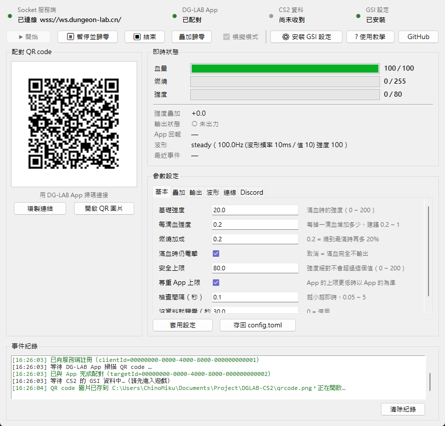
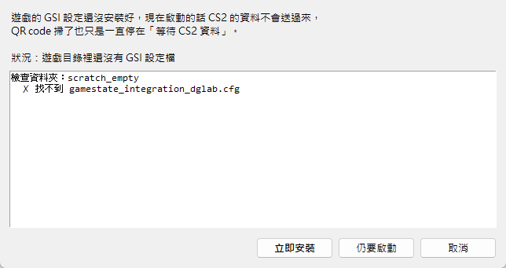
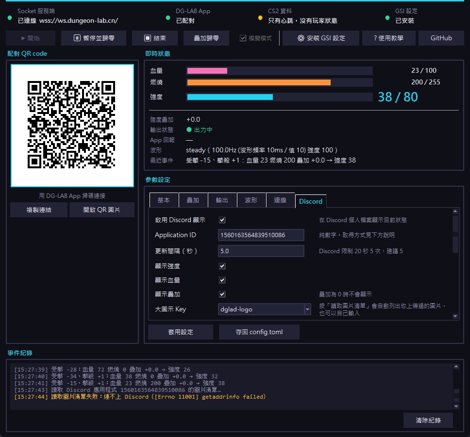
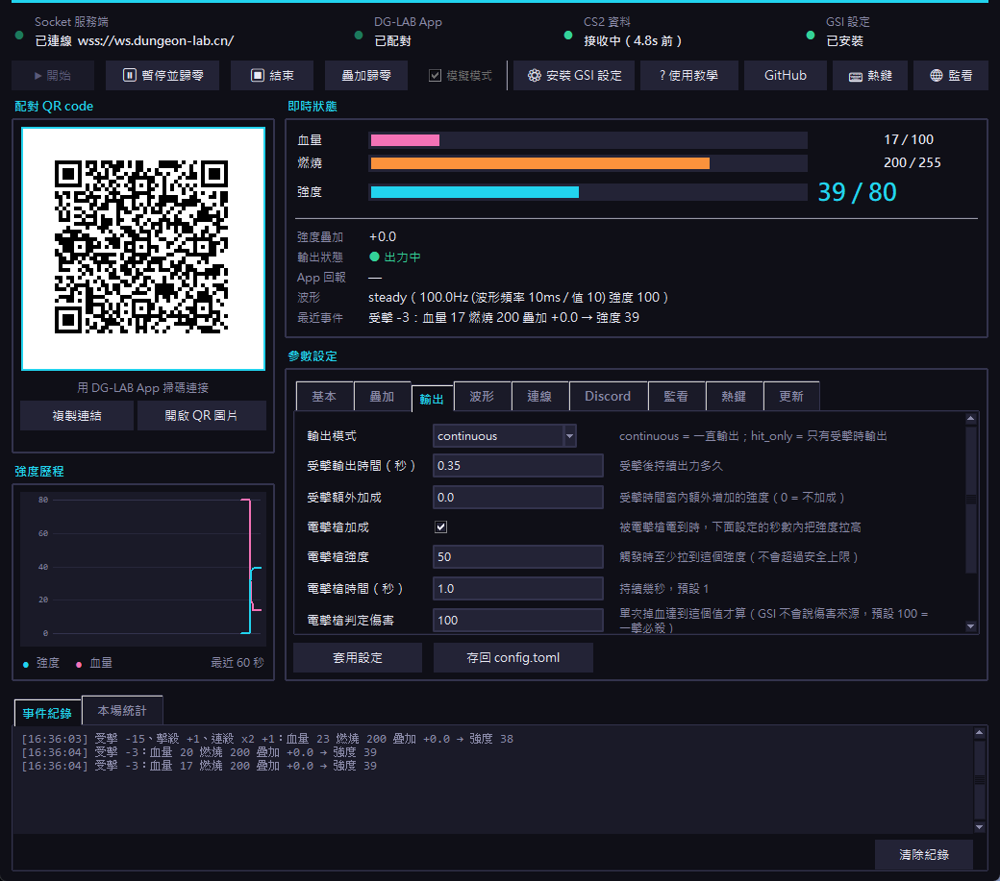

# DGLAB-CS2

**讓 CS2 的血量直接決定郊狼的電擊強度。**


透過 **DG-LAB Socket 開放接口**連線：程式連上中繼伺服器後取得一組配對 ID，
把它畫成 QR code，你用 DG-LAB App 掃一下就連上了 —— **完全不需要藍牙**，
也不用安裝任何驅動。

<p align="center">
  
</p>

> 本專案基於 [shilapi/DGLAB-CS2](https://github.com/shilapi/DGLAB-CS2) **重寫**，
> 改成只支援郊狼 3.0（DG-LAB Coyote V3）並改用 Socket 連線。
> 原始碼以 GPL-3.0 釋出。

---

## 🚀 快速開始

### 方法一：下載打包好的執行檔（推薦）

1. 到 [**Releases**](../../releases/latest) 下載 `DGLAB-CS2-portable.zip` 並解壓
2. 執行 `DGLAB-CS2-portable.exe`
3. 按 **「⚙ 安裝 GSI 設定」** → 重新啟動 CS2 → 用 DG-LAB App 掃 QR code

就這三步，其他都不用設定。

> 兩種打包格式的差別見 [單一 exe 版 vs 資料夾版](#單一-exe-版-vs-資料夾版)，
> 建議用資料夾版（啟動快、不依賴暫存目錄）。

### 方法二：從原始碼執行

```powershell
git clone https://github.com/talkouki89/DGLAB-CS2.git
cd DGLAB-CS2
pip install -r requirements.txt
python main_gui.py
```

### 第一次使用：三個步驟

1. **按「⚙ 安裝 GSI 設定」**
   程式會自動掃描所有 Steam 媒體庫，找到 CS2 的 cfg 目錄，
   並**依你目前的連接埠與 token 產生**設定檔寫進去 ——
   不用自己找路徑、也不用改檔案。
2. **按「▶ 開始」**（其實開程式就會自動連線），等 QR code 出現，
   用 DG-LAB App 掃碼連接（App 首頁右上角 → 掃碼連接）。
3. **進遊戲**。「CS2 資料」燈號變成綠色「接收中」就開始連動了。

介面上的「**? 使用教學**」按鈕有完整的圖文步驟、玩法建議與常見問題。

---

## 目錄

- [⚠️ 安全提醒（請務必先讀）](#️-安全提醒請務必先讀)
- [會不會被 VAC ban？](#會不會被-vac-ban)
- [功能列表](#功能列表)
- [CS2 GSI 的兩個坑（已修正）](#cs2-gsi-的兩個坑已修正)
- [運作原理](#運作原理)
- [兩種主要玩法](#兩種主要玩法)
- [這個版本和原版差在哪裡](#這個版本和原版差在哪裡)
- [環境需求](#環境需求) ／ [安裝](#安裝)
- [反應速度](#反應速度)
- [使用（圖形介面）](#使用圖形介面推薦)
  - [第一次使用：三個步驟](#第一次使用三個步驟)
  - [啟動前的 GSI 檢查](#啟動前的-gsi-檢查)
  - [Discord Rich Presence](#discord-rich-presence選用)
  - [隨時可以做的事](#隨時可以做的事)
- [使用（命令列版）](#使用命令列版)
- [命令列選項](#命令列選項)
- [設定說明（`config.toml`）](#設定說明configtoml)
- [波形是怎麼運作的](#波形是怎麼運作的)
- [打包成 exe](#打包成-exe)
- [測試](#測試)
- [疑難排解](#疑難排解)
- [專案結構](#專案結構)
- [更新記錄](#更新記錄)
- [開發](#開發)
- [授權與致謝](#授權與致謝)

---

## ⚠️ 安全提醒（請務必先讀）

這是一個會控制電擊裝置的程式。

- **先只跑 `--dry-run` 確認流程正常**，再連接實機。
- `config.toml` 的 **`max_strength` 是硬性上限**，程式不會送出超過這個值的強度；
  如果 App 上設定的強度上限更低，預設還會以 App 的為準。
  請從一個你確定能承受的低值（例如 30）開始試。
- 電極請貼在**不會經過心臟、頸部、頭部**的位置，並避開傷口。
- 有心臟疾病、裝有心律調節器者請勿使用。
- 請勿在駕駛、操作機械或無法即時反應的狀態下使用。
- 使用中若感到不適請立刻停止程式（Ctrl+C 會自動把強度歸零、清空波形），
  或直接在 App 上把強度歸零、關閉郊狼電源。

---

## 會不會被 VAC ban？

**結論：這個程式不會讓你被 VAC ban。** 下面是理由，以及你該自己判斷的部分。

### 為什麼不會

本程式用的是 **Valve 官方的 Game State Integration（GSI）** ——
一個 Valve 自己做給第三方整合用的功能。最直接的證據就在你自己的遊戲目錄裡：

```
...\game\csgo\cfg\
    gamestate_integration_logitech.cfg      ← 羅技的鍵盤燈效
    gamestate_integration_steelseries.cfg   ← SteelSeries 的燈效
    gamestate_integration_dglab.cfg         ← 本程式（同一套機制）
```

羅技、SteelSeries、實況台的資訊覆蓋層、賽事轉播用的都是同一個機制。

關鍵在資料的**方向**：

```
   CS2  ──主動 POST──►  本程式      ← 遊戲把狀態「推」給我們
   本程式 ─────X─────►  CS2         ← 我們完全不碰遊戲
```

| 本程式做的事 | 本程式**不**做的事 |
|---|---|
| 開一個本機 HTTP 伺服器，等遊戲送資料過來 | ❌ 不讀取遊戲記憶體 |
| 讀取 `.cfg` 裡指定要訂閱的欄位 | ❌ 不注入 DLL、不 hook DirectX |
| 控制一個**外部的**電擊裝置 | ❌ 不修改遊戲執行檔 |
| 寫一個設定檔到遊戲的 cfg 目錄 | ❌ 不送出任何鍵盤／滑鼠輸入 |

最後一點最重要：**這個程式完全不會操作遊戲**。它不會幫你瞄準、不會幫你壓槍、
不會自動移動、不會替你按任何鍵 —— 它只是在你被打到的時候電你一下。
真要說的話，它讓遊戲變**更難**，不是更容易。

### VAC 實際上抓什麼

VAC 抓的是**作弊程式的特徵**（記憶體裡的已知作弊碼）與伺服器端的異常行為，
它不會去翻你的 `autoexec.cfg`，也不會掃描你電腦上裝了哪些程式。
判斷標準可以簡化成一句：**它管的是「被注入的優勢」，不是「設定」**。

| 分類 | 例子 |
|---|---|
| ✅ 安全 | config／autoexec 修改、按鍵綁定、覆蓋層與工具（Discord、Steam 覆蓋層、效能監測、錄影軟體） |
| ⚠️ 灰色地帶 | **代替你操作的自動化**：連跳腳本、無後座力巨集、自動開火 |

本程式屬於前者，而且是其中「完全不影響遊戲」的那一種。

### 但你還是該注意這幾件事

1. **這不是 Valve 的官方保證。** 我不是 Valve，上面是基於 GSI 的設計與
   VAC 的公開說明所做的判斷。**Valve 的政策隨時可能改變。**
2. **第三方平台有自己的規則。** FACEIT、ESEA 之類的平台有自己的反作弊用戶端
   與規章，對「讀取遊戲狀態的外部程式」可能有不同認定。要去那裡玩之前請先確認。
3. **比賽規章可能另有規定。** 有些賽事禁止任何外部工具，即使它不影響遊戲。
4. **GSI 設定檔要放進遊戲目錄。** 那是 Valve 官方機制的必要步驟
   （`game/csgo/cfg/`），和「修改遊戲檔案」無關。CS2 更新時可能會把它清掉，
   程式會偵測到並提醒你重裝。
5. **原始碼是公開的。** 你可以自己（或請懂的人）檢查它到底做了什麼 ——
   就是純 Python，只用到 `websockets`／`qrcode`／`pillow` 三個套件，
   沒有任何原生擴充、驅動或混淆過的程式碼。

### 參考資料

- [Valve 官方 GSI 文件](https://developer.valvesoftware.com/wiki/Counter-Strike:_Global_Offensive_Game_State_Integration)
- [Valve Anti-Cheat 說明](https://developer.valvesoftware.com/wiki/Valve_Anti-Cheat)

---

## 功能列表

### 電擊邏輯

| 功能 | 說明 |
|---|---|
| 強度隨血量變化 | 血量越低越強，曲線可調（基礎值、每滴血增量、燃燒加成） |
| 燃燒彈加成 | 著火時額外增加強度 |
| 強度疊加 | 死亡增加、擊殺降低，跨回合累積 |
| 受擊同步電擊 | `hit_only` 模式：平常完全不出力，被打到才電 |
| 被電擊槍電到 | 一擊必殺時給予一段時間的高強度加成（可設定值／秒數） |
| 死亡後歸零 | 陣亡後幾秒自動把強度歸零，可開關 |
| 安全上限 | 硬性上限，且預設會尊重 App 上更低的上限 |
| 沒資料就歸零 | 遊戲當掉或關掉後自動歸零，不會一直電著 |

### 連線與介面

| 功能 | 說明 |
|---|---|
| Socket 連線 | 掃 QR code 配對，**不需要藍牙**、不用裝驅動 |
| 圖形介面 | 即時監看、開始／暫停歸零／緊急停止、參數熱調整 |
| 一鍵安裝 GSI 設定 | 自動找到遊戲目錄，依你的連接埠與 token 產生 cfg |
| 啟動前 GSI 檢查 | 沒裝好就不顯示 QR code，並列出搶同一個埠的其他 cfg |
| 參數存回 `config.toml` | 保留註解地就地改寫，並自動備份 |
| Discord Rich Presence | 顯示目前強度與遊玩狀態，可選圖片、可開關 |
| 事件紀錄 | 畫面上即時顯示，同時寫進 `dglab-cs2.log` |

### 品質

| 功能 | 說明 |
|---|---|
| 事件驅動控制迴圈 | 受擊到電下去約 **2ms**（見[反應速度](#反應速度)） |
| 完全離線的測試套件 | **539 項**，不需要網路、App、郊狼或 CS2 |
| 命令列版本 | 要寫自動化腳本時可以用 `main.py` |

---

## CS2 GSI 的兩個坑（已修正）

這兩個問題都不是本程式原創的 bug，而是 **CS2 GSI 本身的陷阱**，
任何讀 GSI 的程式都會踩到。記錄下來給未來的自己（和別人）。

### 坑一：死亡後觀戰別人，`player` 區塊會變成對方的

CS2 在你死掉、開始看別人視角之後，**會把 GSI 的 `player` 區塊換成你正在
看的那個人的資料**——生命值、每回合擊殺、武器、金錢全部都是他的。

所以血量從 0 跳成對方的血量時，程式就以為你復活了。

修正方式是比對兩個 SteamID：

| 欄位 | 是誰 |
|---|---|
| `provider.steamid` | 執行遊戲的人（永遠是自己） |
| `player.steamid` | 當前 `player` 區塊描述的人（觀戰時是對方） |

兩者不同就代表那一包不是自己的資料。這時程式只更新「我死了」這件事，
生命值繼續沿用自己最後一次已知的值，**強度不會跟著被觀戰者的血量跑**，
也不會觸發復活。

判斷需要 cfg 的 `data` 區塊有 `provider` 與 `player_id`
——用「安裝 GSI 設定」產生的檔案一定有；檢查時如果發現少了，程式會提醒你。

### 擊殺漏接

有三個原因，都修掉了：

1. **`round_kills` 每回合會歸零，但旧程式碼不會把 0 寫回去**
   （`if ... and kills != 0`）。於是新回合的基準點還停在上一回合的數字，
   你新回合的第一個擊殺算出來是負的，就被當成沒有擊殺。
2. **觀戰時對方的 `round_kills` 變成你的基準點**，復活後自己的擊殺也算不出來。
3. 改用 **`match_stats.kills`（整場累計、單調遞增）** 當擊殺偵測的主要來源，
   它不受回合重置影響；沒有這個欄位時才退回 `round_kills`。

另外加了合理性檢查：單次取樣出現 5 殺以上（代表基準點跑掉了，例如換地圖或
中途加入）只重新同步，不會一次噴出大量擊殺。相關程式碼在
[`game_events.py`](game_events.py)。

---

## 運作原理

```
┌───────────────┐  GSI (HTTP POST)   ┌────────────────┐
│   CS2 遊戲     │ ─────────────────► │  DGLAB-CS2     │
└───────────────┘   localhost:3000   │  主程式         │
                                     └───────┬────────┘
                                             │ WebSocket
                                             ▼
                                  ┌──────────────────────┐
                                  │ ws.dungeon-lab.cn    │  DG-LAB 中繼伺服器
                                  └──────────┬───────────┘
                                             │ WebSocket
                                             ▼
                                     ┌───────────────┐  藍牙   ┌──────────┐
                                     │ DG-LAB App    │ ──────► │ 郊狼 3.0 │
                                     └───────────────┘         └──────────┘
```

**配對流程：**

1. 程式連上 `wss://ws.dungeon-lab.cn/`。
2. 服務端回一則 `{"type":"bind","clientId":"…","message":"targetId"}`，
   程式記下 `clientId`，並把它組成 QR code 內容：

   ```
   https://www.dungeon-lab.com/app-download.php#DGLAB-SOCKET#wss://ws.dungeon-lab.cn/<clientId>
   ```

3. 程式把 QR code 畫在終端機上（同時存一張 PNG）。
4. 你打開 DG-LAB App → 掃碼連接 → 服務端回 `{"type":"bind","message":"200"}`，配對完成。
5. 之後程式就能下強度指令與波形；App 也會回報強度與按鈕。

**指令：**

| 指令 | 說明 |
|---|---|
| `strength-<通道>+<模式>+<值>` | 通道強度。通道 1=A、2=B；模式 0=降低、1=增加、2=設定為 |
| `pulse-<通道>:[…]` | 波形佇列。通道是字母 A/B，內容是一串 8 bytes 的波形單位 |
| `clear-<通道>` | 清空波形佇列。通道是數字 1/2 |

每個波形單位代表 100ms 的輸出（4 組頻率 + 4 組強度）。程式會把 App 的波形佇列
維持在 **0.5 ~ 3 秒的領先量**：不夠就補、太多就先不補，這樣長時間掛機也不會把
App 的 500 單位（50 秒）佇列塞滿而讓後面的變化延遲 50 秒才出現。
需要「立刻反應」的時候（受擊）則是先 `clear` 再補上爆發波形，完全沒有排隊延遲。

---

## 兩種主要玩法

### 1. 強度疊加（死亡增加、擊殺降低）

除了血量算出來的強度之外，另外維護一個「疊加值」：

- 每次**陣亡**：`+stack_death_gain`
- 每次**擊殺**：`-stack_kill_reduction`
- 最終夾在 `stack_min` ~ `stack_max` 之間

疊加值會**跨回合保留**，所以連續死幾次會越來越痛，靠擊殺才能慢慢扣回來。

```
最終強度 = 基礎強度 + (100 - 血量) × strength_per_hp × 燃燒加成 + 疊加值
```

以預設值（基礎 20、每滴血 0.2、死亡 +5、擊殺 -2）為例：

| 狀況 | 疊加值 | 強度 |
|---|---|---|
| 開局滿血 | 0 | 20 |
| 陣亡 | +5 | 75 |
| 復活（滿血） | +5 | 25 |
| 之後擊殺 1 個 | +3 | 23 |

要關掉就把 `stack_enabled` 設成 `false`。

### 2. 受擊時同步電擊（不受擊不電擊）

把 `output_mode` 設成 `"hit_only"`：

- 平常**完全不出力**（送出的波形是「暫停」波形）。
- 一旦偵測到掉血（或陣亡），**立刻清空佇列並補上一段爆發波形**，
  持續 `hit_duration` 秒；時間到就自己安靜下來。

`hit_boost` 則是兩種模式都有效：受擊後的時間窗內額外加上這麼多強度，
讓「被打到」的感覺更明顯。搭配 `continuous` 模式就是「平常一直有感覺，
被打到時額外電一下」。

> **偵測方式**：程式每 `poll_interval` 秒比較一次血量。CS2 的 GSI 是狀態推送，
> 掉血太快（例如一次爆頭）只會看到「血量從 100 變 0」，這仍然會被判定成受擊／陣亡。
> 但**同一瞬間的多筆變化會被合併成一次**，這是 GSI 的先天限制。

---

## 這個版本和原版差在哪裡

### 1. 修正了「強度隨血量變化」根本不會動的 bug

原版 `main.py` 的核心邏輯長這樣：

```python
if hp[0] == 100 and not keep_strength_while_not_injured:
    await dglab_instance.set_strength_sync(0, 0)
elif hp[0] == 100 and keep_strength_while_not_injured:
    await dglab_instance.set_strength_sync(BASE_STRENGTH + strength_offset, 0)
```

兩個分支都要求 `hp[0] == 100`，**所以只要玩家受傷就完全不會更新強度**，
核心功能根本不會生效。（上游 [issue #1](https://github.com/shilapi/DGLAB-CS2/issues/1)
的回報者建議把 `elif` 改成 `else`，作者卻補上 `hp[0] == 100`，反而更糟。）
本版本由 [`strength.py`](strength.py) 重寫並加上回歸測試。

### 2. 改成 Socket 連線，不再需要藍牙

原本靠 `bleak` 直接連 BLE。改成 DG-LAB 官方 Socket 開放接口之後：

- 不用藍牙、不用配對驅動，電腦只要連得到 `ws.dungeon-lab.cn` 就行。
- 手機（App）和電腦可以不在同一個房間。
- 波形直接以 8 bytes 的 V3 格式送給 App，不用自己處理 BLE 的 100ms 寫入節奏。

### 3. 自己實作波形換算，不再依賴 `pydglab`

`pydglab` 的 V3 波形換算與官方文件不符：

| V2 波形 `(X, Y, Z)` | 官方換算（V3 波形頻率 = `X+Y` 壓縮後） | `pydglab` 算出來的 |
|---|---|---|
| `(1, 9, 20)` | 10 | 10 |
| `(5, 35, 20)` | **40** | 16 ❌ |

而且它每個週期只推進一個取樣點（正確要 4 個）。本專案直接依官方文件實作。

### 4. 補上原版沒有的安全機制

| 機制 | 說明 |
|---|---|
| 強度上限 | 送出的值一定夾在 `0 ~ max_strength`，預設還會尊重 App 上的上限 |
| 遊戲關掉自動歸零 | 超過 `stop_when_no_data_seconds` 秒沒收到 GSI 資料就歸零並停止輸出 |
| 離開自動歸零 | Ctrl+C 或程式結束前一定先清空波形、把強度設成 0 |
| 滿血保護 | 還沒收到真正的玩家狀態前（例如只收到 heartbeat）不會拉高強度 |
| 設定驗證 | 所有設定在啟動時就驗證，錯誤會直接告訴你哪一項不對 |

### 5. 其他修正

- HTTP 回應標頭順序（原版先 `send_header` 才 `send_response`，送出的是格式錯誤的回應）。
- 改用 `ThreadingHTTPServer`，單一請求卡住不會讓整個 GSI 停擺。
- `player.state.health` 的初始值從 `0`（會被誤判成死亡 → 最高強度）改成 `100`。
- 移除死碼與 2.0 專用檔案。

---

## 環境需求

| 項目 | 需求 |
|---|---|
| 作業系統 | Windows 10 / 11（其他平台應該也能跑，但未經測試） |
| Python | 3.11 以上（會用到內建的 `tomllib`） |
| 網路 | 能連到 `wss://ws.dungeon-lab.cn/` |
| 手機 | 安裝 DG-LAB App，並與郊狼 3.0 完成藍牙連線 |
| 裝置 | 郊狼 3.0 脈衝主機 |

> 郊狼 **2.0 不支援**。

---

## 安裝

```powershell
# 1. 安裝相依套件
python -m pip install -r requirements.txt

# 2. 把 GSI 設定檔放到 CS2 的 cfg 目錄
#    <Steam>\steamapps\common\Counter-Strike Global Offensive\game\csgo\cfg\
#    複製 gamestate_integration_dglab.cfg 進去即可

# 3. 先不連服務端，用假的流程跑一遍
python main.py --dry-run
```

---

### 反應速度

從「CS2 判定你被打到」到「郊狼真的電下去」中間會經過好幾段，實際量測如下：

| 環節 | 延遲 | 能不能控制 |
|---|---|---|
| CS2 送出 GSI 資料 | 最多 50ms（`buffer`／`throttle`） | ✅ 程式產生的 cfg 已調到 0.05 |
| 本程式收到並算出新強度 | **約 2ms** | ✅ 事件驅動（見下） |
| 電腦 → 中繼伺服器 → 手機 App | 約 150～300ms | ❌ 取決於網路距離 |
| 手機 → 藍牙 → 郊狼 | 約 20～100ms | ❌ 硬體 |

**本程式是事件驅動的**：一收到 CS2 的 GSI 資料就立刻處理，
而不是每隔一段時間才去看一次。實際量測（真的 POST 到 GSI 伺服器）：

```
事件驅動    最短 1.8ms   中位數 2.0ms   最長 2.5ms
固定輪詢    最短 24.5ms  中位數 162.7ms 最長 179.2ms
```

`poll_interval`（預設 0.1 秒）現在只是保底：安全看門狗、畫面狀態刷新，
以及完全沒有 GSI 資料時的心跳。按「暫停」或「結束」也會立刻叫醒控制迴圈，
不用等這個間隔。

> 剩下的延遲主要來自「電腦 → 中繼伺服器 → 手機」這一段，
> 那是網路距離造成的，程式改不了。如果你離 `ws.dungeon-lab.cn` 很遠，
> 可以自己架一個近一點的中繼伺服器，把 `socket.uri` 指過去。

> ⚠️ 如果你之前已經裝過 GSI 設定，想拿到新的 `throttle` 值要**重新按一次
> 「⚙ 安裝 GSI 設定」**並重啟 CS2 —— 舊的 cfg 還是 0.1。

---

## 使用（圖形介面，推薦）

執行 `DGLAB-CS2.exe`（或 `python main_gui.py`）就會開啟介面（畫面見[最上面那張圖](#dglab-cs2)）：

畫面分成四塊：

| 區域 | 內容 |
|---|---|
| 狀態列 | Socket 連線、App 配對、CS2 資料、GSI 設定四個燈號 |
| 左半 | 配對 QR code（掃不到螢幕可以存成圖片再掃） |
| 右半上 | 即時數值：血量／燃燒／強度、疊加、輸出狀態、波形、最近事件 |
| 右半下 | 參數設定六個分頁，改完按「套用設定」立刻生效 |
| 底部 | 事件紀錄（同時寫進 `dglab-cs2.log`） |

### 第一次使用：三個步驟

1. **按「⚙ 安裝 GSI 設定」** —— 程式會自動掃描所有 Steam 媒體庫，找到 CS2 的
   cfg 目錄，並**依你目前的連接埠與 token 產生**設定檔寫進去，不用自己找路徑、
   也不用改檔案。
   - 找不到時會請你手動選資料夾（通常是
     `...\Counter-Strike Global Offensive\game\csgo\cfg`）。
   - 如果目錄裡有**其他也指向同一個埠**的 GSI 設定檔，程式會列出來警告你
     ——那些檔案就是「token 不符」訊息的來源。
   - 裝好之後要**重新啟動 CS2**。

   > 其實不按也行：按「開始」時程式會**先檢查 GSI 裝好了沒**，
   > 沒裝好就不會顯示 QR code，而是問你要不要「立即安裝」。

2. **按「▶ 開始」**，等 QR code 出現，用 DG-LAB App 掃碼連接
   （App 首頁右上角 → 掃碼連接）。掃不到螢幕就按「開啟 QR 圖片」改掃圖片檔。
3. **進遊戲**。「CS2 資料」燈號變成綠色「接收中」就開始連動了。

介面上的「**? 使用教學**」按鈕有完整的圖文步驟、四種玩法建議與常見問題。

### 啟動前的 GSI 檢查

程式會確認遊戲那邊的設定真的有效：檔案在不在、連接埠與 token 對不對、
有沒有別的 cfg 搶同一個埠。**沒通過就不會顯示 QR code**：

| 選項 | 作用 |
|---|---|
| 立即安裝 | 自動裝好（或更新）之後直接繼續啟動 |
| 仍要啟動 | 略過檢查，自己知道後果時才用 |
| 取消 | 先不啟動 |

畫面上方的「GSI 設定」燈號會持續顯示狀態
（🟢 已安裝 ／ 🟠 已安裝但有衝突 ／ 🔴 未安裝），而且每 10 秒重新掃描一次
—— 檔案被 CS2 更新或自己整理掉之後，你會馬上知道，而不是進了遊戲才發現
強度都不會動。

<p align="center">
  
</p>

### Discord Rich Presence（選用）

可以在 Discord 個人檔案上顯示目前狀態，例如：

```
DGLAB-CS2
  CS2 對戰中
  強度 42／80　血量 68　疊加 +5
```

**開箱即用**：`config.toml` 裡已經填好本專案的 Application ID 與圖片，
只要到介面上的「Discord」分頁勾選「啟用 Discord 顯示」再按「套用設定」就可以了，
不需要自己建任何東西。Discord **桌面版**要開著才有效。

分頁下方會顯示連線狀態，按「測試連線」可以馬上送一筆測試狀態。
強度／血量／疊加可以個別開關；更新間隔預設 5 秒（Discord 對更新次數有限制）。
不在 CS2 裡的時候顯示「待機中」，沒配對時顯示「等待 App 配對」，
暫停時顯示「已暫停」，所以一眼就看得出目前的狀態。

<p align="center">
  
</p>

#### 想換成自己的名稱與圖片

顯示的**應用名稱與圖片都是跟著 Application ID 走的**，所以想用自己的品牌時：

1. 到 <https://discord.com/developers/applications>（需要登入 Discord）
2. **New Application** → 取個名字，例如 `DGLAB-CS2`
3. **General Information** → 複製 **Application ID**，貼到「Application ID」欄位
4. 左邊選 **Rich Presence → Art Assets** → **Add Image(s)** 上傳圖片並幫它取名字
5. 回到程式按 **「讀取圖片清單」**，兩個 Key 欄位會變成下拉選單讓你直接挑
   （Application ID 填完、焦點移開時也會自動讀一次）

不想用圖片就把 Key 欄位清空，狀態只會顯示文字。

#### 大圖示／小圖示的細節

Discord 的圖片要用 **asset key**（圖片在開發者頁面上的名字），
**不能填本機檔案路徑**。

讀取用的是 Discord 的 `GET /oauth2/applications/{id}/assets`
——這個端點**不需要 token**，所以不必提供任何金鑰給本程式。
讀過的清單會依 Application ID 快取，同一次執行不會重複打 API。

對應的「提示」欄位是滑鼠移上去時顯示的文字；沒有圖片時 Discord 會忽略它，
所以程式也只在你填了圖片 key 時才送出。剛上傳的圖片可能要等幾分鐘才會生效。

> 那個端點會被 CDN 快取，所以程式每次都會帶一個時間戳去要最新清單
> ——不然剛上傳完圖片會看到舊的名字。
>
> 上傳時選 Big 的素材會排在大圖示下拉選單前面，選 Small 的排在小圖示前面；
> 兩種其實可以互換使用，所以只是排序、不會過濾掉任何一張。

### 隨時可以做的事

| 按鈕 | 作用 |
|---|---|
| ▶ 開始 / ⏸ 暫停並歸零 | 暫停會**立刻把強度歸零**並停止套用變化，但**不會斷線**；再按一次（變成「▶ 繼續」）就恢復 |
| ⏹ 結束 | 停止引擎，離線前會先清空波形、把強度歸零 |
| 疊加歸零 | 把死亡／擊殺累積的疊加值歸零 |
| 套用設定 | 讓參數設定**立刻生效**（連線層級的項目會提示需要重新啟動） |
| 存回 config.toml | 把畫面上的設定寫回檔案（原檔備份成 `config.toml.bak`，**註解會保留**） |
| 模擬模式 | 不連服務端，只跑流程，用來確認設定是不是你要的 |

程式也會把記錄寫到 exe 旁邊的 `dglab-cs2.log`，出事可以直接看這個檔案。

---

## 使用（命令列版）

不想開視窗、或要寫成自動化腳本時，也可以用命令列版本：

1. 確認 `config.toml` 設定無誤（尤其是 `max_strength`）。
2. 把 `gamestate_integration_dglab.cfg` 複製到 CS2 的 cfg 目錄：

   ```
   <Steam>\steamapps\common\Counter-Strike Global Offensive\game\csgo\cfg\
   ```

   （GUI 版的「安裝 GSI 設定」按鈕就是自動做這件事。）
3. 執行：

   ```powershell
   python main.py
   ```

4. 終端機會出現一個 QR code：

   ```
   ==============================================================
     請用 DG-LAB App 掃描下面的 QR code 完成配對
     （App 首頁右上角 → 掃碼連接）
   ==============================================================

     ████████████████████████████████
     ██ ▄▄▄▄▄ █▀▀ █▀█▄▀▀▀ █ ▄▄▄▄▄ ██
     …
     QR code 圖片：C:\…\qrcode.png
     連結：https://www.dungeon-lab.com/app-download.php#DGLAB-SOCKET#…
   ```

   掃不到終端機的圖時，直接掃 `qrcode.png`（預設會自動打開）。

5. 打開 DG-LAB App → 掃碼連接 → 配對完成，程式會顯示
   `已與 App 完成配對`。
6. 開啟 CS2。進入遊戲後就會自動開始依血量調整強度。
7. 按 `Ctrl+C` 結束（會自動把強度歸零、清空波形再斷線）。

也可以開瀏覽器到 <http://127.0.0.1:3000/> 查看 GSI 的接收狀態。

---

## 命令列選項

```
python main.py [選項]

  --config PATH                設定檔路徑（預設 config.toml）
  --dry-run                    不連服務端，用假的 Socket 流程跑一遍
  --socket-uri URI             覆寫 Socket 服務端位址
  --channels {A,B,AB}          要輸出波形的通道
  --output-mode MODE           continuous 或 hit_only
  --base-strength N            覆寫基礎強度
  --max-strength N             覆寫安全上限
  --strength-per-hp N          覆寫每滴血的強度
  --wave NAME                  覆寫波形預設集
  -v, --verbose                開啟 debug 記錄（會列出每一則 Socket 訊息）
```

範例：只想在受擊時電、而且平常不要電得太兇

```powershell
python main.py --output-mode hit_only --base-strength 15 --max-strength 45
```

---

## 設定說明（`config.toml`）

### `[gsi]`

| 名稱 | 預設 | 說明 |
|---|---|---|
| `host` | `"127.0.0.1"` | 監聽位址 |
| `port` | `3000` | 監聽埠，**必須和 cfg 檔的 `uri` 一致** |
| `token` | `"DGLAB"` | 驗證 token，**必須和 cfg 檔的 `auth.token` 一致**；設成空字串 `""` 代表接受任何來源 |

### `[socket]`

| 名稱 | 預設 | 說明 |
|---|---|---|
| `uri` | `"wss://ws.dungeon-lab.cn/"` | DG-LAB Socket 服務端 |
| `register_timeout` | `20.0` | 等 `clientId` 的逾時（秒） |
| `qr_invert` | `true` | 終端機 QR code 是否反相（深色背景請保持 `true`） |
| `qr_png` | `"qrcode.png"` | QR code 圖片輸出路徑，空字串 = 不輸出 |
| `qr_open` | `true` | 產生圖片後自動打開 |

### `[dglab]`

| 名稱 | 預設 | 說明 |
|---|---|---|
| `channels` | `"A"` | 輸出通道：`A` / `B` / `AB` |
| `max_strength` | `80` | **安全上限**（0 ~ 200） |
| `respect_app_limit` | `true` | App 的強度上限更低時，以 App 的為準 |
| `poll_interval` | `0.25` | 檢查血量的間隔（秒） |
| `stop_when_no_data_seconds` | `30.0` | 多久沒收到 GSI 資料就歸零；`0` = 停用 |
| `base_strength` | `20` | 滿血時的基礎強度 |
| `strength_per_hp` | `0.2` | 每掉一滴血增加多少強度（建議 0.2 ~ 1） |
| `keep_strength_while_not_injured` | `true` | 滿血時是否仍電擊 |
| `burning_multiplier` | `0.2` | 燃燒彈加成倍率 |
| `stack_enabled` | `true` | 是否啟用強度疊加 |
| `stack_death_gain` | `5` | 每次陣亡累加的強度 |
| `stack_kill_reduction` | `2` | 每次擊殺扣回的強度 |
| `stack_min` / `stack_max` | `0` / `30` | 疊加值的上下限 |
| `output_mode` | `"continuous"` | `continuous` = 一直輸出；`hit_only` = 只有受擊時輸出 |
| `hit_duration` | `0.35` | 受擊後持續輸出／加成的秒數 |
| `hit_boost` | `0` | 受擊時間窗內額外增加的強度 |
| `taser_enabled` | `true` | 被電擊槍電到時是否給予加成 |
| `taser_strength` | `50` | 觸發時至少拉到的強度（仍受 `max_strength` 限制） |
| `taser_duration` | `1.0` | 加成持續幾秒 |
| `taser_min_damage` | `100` | 單次掉血達到這個值才算（0 = 停用判斷） |
| `death_stop_enabled` | `true` | 死亡後是否把強度歸零 |
| `death_stop_delay` | `5.0` | 死亡後幾秒歸零 |

### 被電擊槍電到（`taser_*`）

GSI **不會告訴我們傷害是誰造成的**，所以只能用「單次掉了多少血」判斷。
電擊槍（Zeus x27）是一擊必殺（傷害 500），所以門檻預設 100
——也就是「一次就被打到 0 血」。

> ⚠️ AWP 爆頭、近戰背刺之類的一擊必殺也會符合這個條件，GSI 沒有提供
> 傷害來源，沒辦法再細分。

觸發時會先清空波形佇列、補上一段 `taser_duration` 秒的爆發波形，
並在這段時間內把強度拉到 `taser_strength`（如果原本的強度更高就維持原樣，
不會被壓下來）。最後仍然受 `max_strength` 這個安全上限限制。

### 死亡後歸零（`death_stop_*`）

陣亡後先維持原本的強度，超過 `death_stop_delay` 秒就強制歸零，直到復活為止。
`death_stop_enabled = false` 就會一直維持死亡當下的強度。

電擊槍與死亡歸零都在介面的「輸出」分頁：

<p align="center">
  
</p>

強度計算方式：

```
強度 = clamp(
          base_strength
        + (100 - 血量) × strength_per_hp × (1 + burning_multiplier × burning / 255)
        + 疊加值
        + 受擊加成,
        0, max_strength)
```

### `[dglab.wave]`

| 名稱 | 說明 |
|---|---|
| `preset` | 預設集名稱，見下表 |
| `custom_samples` | `preset = "custom"` 時使用的 `[[波形頻率ms, 波形強度], ...]` |

| 預設集 | 內容 | 對應的舊版 2.0 參數 |
|---|---|---|
| `steady`（預設） | 連續穩定輸出（輸出單元 10ms，波形強度 100） | `set_wave_sync(1, 9, 20)` |
| `slow` | 一下一下的（輸出單元 100ms） | `set_wave_sync(5, 95, 20)` |
| `breathe` | 波形強度在 40 ~ 100 之間來回，500ms 一循環 | — |
| `pulse` | 100ms 開、100ms 關 | — |
| `ramp` | 波形頻率由低到高緩緩上升後循環 | — |
| `app_breathe` | 官方 App 內建「呼吸」波形 | — |
| `app_tide` | 官方 App 內建「潮汐」波形 | — |
| `custom` | 由 `custom_samples` 自訂 | — |

---

## 波形是怎麼運作的

郊狼 3.0 和 2.0 的波形資料格式完全不同：

- **2.0**：`X`（連續 X ms 發脈衝）、`Y`（間隔 Y ms）、`Z`（脈衝寬度）。
- **3.0**：只有「波形頻率」與「波形強度」兩組數字，每個波形單位 100ms。

官方給的換算關係（[脈衝波形解釋](https://github.com/dungeonlab-open/dglab-bluetooth-protocol/blob/main/coyote/README.md)）：

```
V3 波形頻率輸入 = V2 的 (X + Y)，單位是「輸出單元時長 ms」
V3 波形強度     = V2 的 Z × 5

裝置值 = 10 ~ 100  → 輸入值
         101 ~ 600 → (輸入值 - 100) / 5 + 100
         601 ~ 1000 → (輸入值 - 600) / 10 + 200
```

| 輸出單元 | 裝置值 | 脈衝頻率 |
|---|---|---|
| 10ms | 10 | 100Hz |
| 20ms | 20 | 50Hz |
| 50ms | 50 | 20Hz |
| 100ms | 100 | 10Hz |
| 200ms | 120 | 5Hz |
| 600ms | 200 | 1.67Hz |
| 1000ms | 240 | 1Hz |

把 `custom_samples` 排成循環，就會得到持續變化的波形。

---

## 打包成 exe

```powershell
powershell -ExecutionPolicy Bypass -File build.ps1            # 單一 exe（預設）
powershell -ExecutionPolicy Bypass -File build.ps1 -OneDir    # 資料夾版，啟動較快
```

輸出會放在 `dist\`：

```
dist\
  DGLAB-CS2.exe                     ← 雙擊就會開啟圖形介面
  config.toml                       ← 放在 exe 旁邊，可以自由修改
  gamestate_integration_dglab.cfg   ← 也可以改用介面上的「安裝 GSI 設定」
  dglab-cs2.log                     ← 執行後產生的記錄檔
```

建置選項：

```powershell
powershell -ExecutionPolicy Bypass -File build.ps1            # 單一 exe（預設，不開主控台）
powershell -ExecutionPolicy Bypass -File build.ps1 -OneDir    # 資料夾版，啟動較快
powershell -ExecutionPolicy Bypass -File build.ps1 -Console   # 保留主控台視窗（除錯用）
```

### 單一 exe 版 vs 資料夾版

兩種功能**完全一樣**，差別只在 PyInstaller 的打包方式：

| | 單一 `DGLAB-CS2.exe` | 資料夾版 `DGLAB-CS2-portable\` |
|---|---|---|
| 內容 | 就一個 21 MB 的 exe | 3.9 MB 的 exe + `_internal\`（約 1,050 個檔案） |
| 啟動方式 | 每次啟動都把自己解壓到 `%TEMP%` | 直接從資料夾載入，**不解壓** |
| 啟動時間 | 約 1.5 秒 | 約 0.6 秒 |
| 依賴 | **需要 `%TEMP%` 可以寫入** | 不需要暫存目錄 |
| 攜帶 | 單檔最方便 | 整個資料夾要一起帶著，不能只搬 exe |
| 防毒誤判 | 比較容易被攔 | 相對少見 |

**建議用資料夾版**：啟動快、不依賴暫存目錄，出問題的環節最少。
只有在「要傳一個檔案給別人」這種場合才需要單一 exe 版。

如果單一 exe 版跳出標題是 `Error` 的對話框（內容通常是
`Could not create temporary directory`），那就是 `%TEMP%` 不能寫
——改用資料夾版即可，或把 `TEMP` / `TMP` 環境變數指到一個可寫入的資料夾。

`config.toml` **刻意不包進 exe**，這樣你才改得到設定。
程式啟動時會先找「exe 所在目錄」的 `config.toml`，找不到才退回目前工作目錄，
所以雙擊執行、或從任何地方用完整路徑執行都沒問題。

exe 是圖形介面版本，也可以帶參數：

```powershell
.\DGLAB-CS2.exe --dry-run     # 模擬模式：不連服務端，只跑流程
.\DGLAB-CS2.exe --config 我的設定.toml
```

不想開視窗、要寫自動化腳本時，命令列版仍然在 `main.py`（`python main.py`）。
不開主控台的 exe 把所有訊息寫進 `dglab-cs2.log`，出問題先看那個檔案。

> 第一次執行時 Windows Defender 可能會對「沒有簽章的新 exe」跳出警告，
> 選擇「仍要執行」即可（PyInstaller 打包的檔案很常被誤判）。

---

## 測試

所有測試都能在**沒有網路、沒有 App、沒有郊狼、沒有 CS2** 的情況下執行
（用假的 WebSocket 連線扮演服務端與 App）：

```powershell
python -m unittest discover -s tests -t . -v
```

| 測試檔 | 內容 |
|---|---|
| [`tests/test_waveform.py`](tests/test_waveform.py) | 波形換算公式（對照官方對照表）、8 bytes 波形單位編碼、預設集與循環 |
| [`tests/test_socket_protocol.py`](tests/test_socket_protocol.py) | Socket 訊息編解碼：強度／波形／清空指令、App 回報、QR code 內容、錯誤碼 |
| [`tests/test_socket_client.py`](tests/test_socket_client.py) | 註冊、配對、斷線、強度指令、波形串流領先量、受擊爆發、App 上限 |
| [`tests/test_game_events.py`](tests/test_game_events.py) | 受擊／死亡／擊殺／復活的事件偵測（含觀戰誤判的回歸測試） |
| [`tests/test_controller.py`](tests/test_controller.py) | 決策層：強度、疊加、輸出閘門、電擊槍加成、死亡歸零、裝置寫入 |
| [`tests/test_strength.py`](tests/test_strength.py) | 強度策略（含原版 bug 回歸測試）、強度疊加、輸出閘門 |
| [`tests/test_config.py`](tests/test_config.py) | 設定檔解析與各種錯誤情況 |
| [`tests/test_gsi.py`](tests/test_gsi.py) | 真的用 HTTP 打 GSI 伺服器（token 驗證、heartbeat、健康檢查頁） |
| [`tests/test_main.py`](tests/test_main.py) | `GSI POST → control_loop → Socket 指令` 的端到端整合、疊加、受擊模式、看門狗 |
| [`tests/test_qr.py`](tests/test_qr.py) | QR code 終端機繪製與缺少套件時的退化行為 |
| [`tests/test_controller.py`](tests/test_controller.py) | 決策層（事件 → 疊加／輸出閘門／強度）與裝置寫入器 |
| [`tests/test_engine.py`](tests/test_engine.py) | 背景執行引擎：啟動、配對、暫停歸零、恢復、狀態回報、熱套用設定 |
| [`tests/test_config_writer.py`](tests/test_config_writer.py) | 就地改寫 `config.toml` 並保留註解、寫入前驗證、備份 |
| [`tests/test_gui_form.py`](tests/test_gui_form.py) | 介面表單 ↔ 設定的來回轉換與欄位驗證（不需要開視窗） |
| [`tests/test_cs2cfg.py`](tests/test_cs2cfg.py) | 產生 GSI 設定檔、掃描搶同一個埠的 cfg、安裝與備份、媒體庫探索、啟動前健檢 |
| [`tests/test_discord_rpc.py`](tests/test_discord_rpc.py) | Discord IPC 協定：封包編解碼、握手、SET_ACTIVITY 來回、大／小圖示、逾時不卡死 |
| [`tests/test_presence.py`](tests/test_presence.py) | 要顯示什麼內容（純函式）、節流、斷線重連、失敗不影響主程式 |

---

## 疑難排解

| 症狀 | 處理方式 |
|---|---|
| 一直停在「等待 DG-LAB App 掃描 QR code」 | 確認 App 是「掃碼連接」而不是「掃描裝置」；確認手機連得到網路；試著按「開啟 QR 圖片」改掃圖片檔 |
| 找不到遊戲的 cfg 資料夾 | 按「⚙ 安裝 GSI 設定」後手動選擇；位置通常是 `<Steam>\steamapps\common\Counter-Strike Global Offensive\game\csgo\cfg` |
| 每次按「開始」都說 GSI 還沒安裝 | 檔案真的不在遊戲目錄裡。按「立即安裝」讓程式裝回去 |
| 「GSI 設定」燈號是橘色 | 目錄裡有其他也指向同一個埠的 cfg，會造成「token 不符」警告；按「⚙ 安裝 GSI 設定」時會列出是哪些檔案 |
| Discord 顯示一直連不上 | 確認 Discord **桌面版**開著（網頁版沒有 IPC 介面）、Application ID 沒填錯。剛開好 Discord 要等幾秒，程式每 15 秒會自己重試 |
| Discord 上沒有出現狀態 | 檢查「Discord」分頁下方「目前狀態」是否為「已連線」；按「測試連線」會直接告訴你結果 |
| 按了「安裝 GSI 設定」但遊戲沒反應 | GSI 設定要**重新啟動 CS2** 才會生效 |
| 安裝時說沒有寫入權限 | 遊戲裝在 Program Files 之類的位置時，改用系統管理員身分執行本程式 |
| `無法連上 DG-LAB Socket 服務端` | 確認網路可以連到 `wss://ws.dungeon-lab.cn/`；公司或校園網路可能擋 WebSocket |
| `… 秒內沒有收到 clientId` | 同上；也可以換成自己架設的服務端（`socket.uri`） |
| 掃碼後馬上是「配對失敗 400」 | 這個 `clientId` 已經被別的控制器綁定，重開程式取得新的 QR code |
| 遊戲中血量有變但強度沒動 | 打開 <http://127.0.0.1:3000/> 看「已收到資料筆數」有沒有增加。若一直是 0，代表 cfg 檔沒放對位置或 token 不符 |
| 死亡後看別人打，程式亂電 | 不該發生（已修正）。「CS2 資料」燈號會顯示「觀戰別人」；若強度還是跟著跑，確認 cfg 的 data 有 `provider` 與 `player_id`（按「安裝 GSI 設定」重裝一次） |
| 擊殺沒有降低疊加 | 已修正（改用整場累計擊殺數）。若還是漏，把遊戲的 `cl_...` 之類設定調開不影響，請確認 cfg 有 `player_match_stats` |
| 死亡後躺著一直被電 | 「輸出」分頁的「死亡後歸零」打開，並調整延遲秒數 |
| 被電擊槍電到沒有特別感覺 | 確認「電擊槍加成」有開、「電擊槍判定傷害」沒有設得太高（預設 100）。GSI 沒有傷害來源，AWP 爆頭也會一起觸發 |
| 收到 `token 不符的 GSI 資料` | 訊息裡會寫出**收到的 token** 和**來源程式**。最常見的原因是 cfg 目錄裡還有*別的*也指向同一個埠的 `gamestate_integration_*.cfg`（例如以前試過的其他工具），把它們移走或改名即可。若確定只有自己這一份，就檢查兩邊的 token 是否一致；真的不想管 token 就把 `gsi.token` 設成 `""`。 |
| 強度上不去 | App 上的強度上限（或 `max_strength`）太低。`respect_app_limit = true` 時會以 App 的為準 |
| 受擊時反應慢半拍 | 把 `poll_interval` 調小（例如 0.1），並確認 `output_mode` 是 `hit_only` 或 `hit_boost` > 0 |
| 平常不想被電，只想被打到時電 | 把 `output_mode` 設成 `"hit_only"` |
| `無法在 127.0.0.1:3000 啟動 GSI 伺服器` | 埠被佔用（可能已經開了另一份程式）。關掉重複的程式，或改 `gsi.port` 並同步修改 cfg 檔的 `uri` |
| 終端機的 QR code 掃不到 | 把 `qr_open` 設成 `true` 改掃 PNG，或把 `qr_invert` 反過來試 |
| App 中途斷線 | 程式會自動重新顯示 QR code，重新掃一次就會接上 |

---

## 專案結構

```
main_gui.py                    圖形介面進入點（exe 就是打包這支）
gui.py                         tkinter 介面：狀態列、QR、參數分頁、事件紀錄
tutorial.py                    介面裡的「使用教學」文字
engine.py                      背景執行引擎（自己的執行緒 + asyncio loop）
engine_status.py               引擎對外的狀態型別（engine 與 presence 共用）
controller.py                  決策層：事件 → 疊加／輸出閘門／強度 → 裝置指令
config_writer.py               就地改寫 config.toml（保留註解、寫入前驗證）
cs2cfg.py                      產生、檢查、自動安裝 CS2 的 GSI 設定檔
discord_rpc.py                 Discord IPC 協定（自己實作，不依賴第三方套件）
presence.py                    把引擎狀態翻成 Discord 顯示內容並節流送出
main.py                        命令列版進入點（自動化用）
config.py / config.toml        設定讀取與驗證
strength.py                    強度策略、強度疊加、輸出閘門（純函式）
game_events.py                 受擊／死亡／擊殺事件的偵測（純函式）
gsi_server.py                  CS2 GSI 的 HTTP 接收伺服器
gamestate.py / player.py       遊戲狀態模型
map.py / payloadparser.py      GSI 封包解析
coyote/socket_protocol.py      Socket 訊息編解碼（純函式）
coyote/socket_client.py        配對、強度指令、波形串流
coyote/transport.py            WebSocket 傳輸層（含 dry-run 用的假傳輸層）
coyote/waveform.py             波形換算、預設集、8 bytes 波形單位
coyote/qr.py                   QR code 繪製（終端機 + PNG）
tests/                         離線測試套件（539 項，不需要網路／App／裝置）
docs/                          README 用的截圖
build.ps1                      PyInstaller 打包腳本
```

---

## 更新記錄

### v3.0.0 — 目前版本

**新增**

- 圖形介面（tkinter）：即時監看、開始／暫停歸零／結束、參數熱調整、事件紀錄
- 一鍵把 GSI 設定裝進遊戲目錄（自動掃描所有 Steam 媒體庫）
- 啟動前的 GSI 檢查：沒裝好就不顯示 QR code，並列出搶同一個埠的其他 cfg
- Discord Rich Presence：顯示目前強度與遊玩狀態，可選圖片、可開關
- 被電擊槍電到時給予一段時間的強度加成（可設定強度／秒數）
- 死亡後過幾秒把強度歸零（可開關）
- 控制迴圈改成**事件驅動**：受擊到電下去的延遲從 163ms 降到 **2ms**
- 命令列與圖形介面共用同一份決策層（`controller.py`），行為不會不一致

**修正**

- 死亡後觀戰別人被誤判成「復活」，而且強度會跟著被觀戰者的血量跑
- 擊殺漏接：`round_kills` 在回合重置時不會寫回 0，導致下一回合第一殺被吃掉；
  改用整場累計的 `match_stats.kills`
- 觀戰時對方的擊殺數會污染自己的基準點
- 暫停／結束時控制迴圈要等到下一個輪詢間隔才反應
- 產生的 cfg 與專案內的靜態 cfg 分岔（throttle 不一致）
- Discord 圖片清單被 CDN 快取，剛上傳的圖片看不到
- 從背景執行緒呼叫 tkinter（會靜默失效，導致圖片清單讀不出來）

### 與原版（shilapi/DGLAB-CS2）的差異

見[這個版本和原版差在哪裡](#這個版本和原版差在哪裡)。

---

## 開發

### 環境

- Python 3.10 以上（開發時使用 3.12）
- 相依套件只有三個：`websockets`、`qrcode`、`pillow`

```powershell
python -m venv .venv
.venv\Scripts\Activate.ps1
pip install -r requirements.txt
```

### 執行

```powershell
python main_gui.py          # 圖形介面
python main.py              # 命令列版
python main_gui.py --dry-run   # 模擬模式：不連服務端，只跑流程
```

### 測試

```powershell
python -m unittest discover -s tests -t . -v
```

測試套件**完全離線**，不需要網路、DG-LAB App、郊狼或 CS2
——用假的 WebSocket 傳輸層扮演服務端與 App，用真的 HTTP POST 打自己的 GSI 伺服器。
通過標準是 539 項全過（有 2 項會在缺少 `qrcode` 時跳過）。

設計上刻意把邏輯與 I/O 分開，所以大多數規則都是純函式、可以直接測：

- `strength.py`／`game_events.py`／`controller.py`：決策規則，不碰網路與 UI
- `engine.py`：背景執行引擎，自己的執行緒 + asyncio loop
- `gui.py`：只負責畫面，所有規則都跟命令列版共用同一份

### 貢獻

歡迎開 issue 或 PR。如果是要改電擊行為，請一併附上測試
（`tests/test_strength.py` 或 `tests/test_controller.py`）。

---

## 授權與致謝

以 **GPL-3.0** 釋出，與原專案相同（見 [LICENSE](LICENSE)）。

本專案是 [shilapi/DGLAB-CS2](https://github.com/shilapi/DGLAB-CS2) 的**重寫版**：
改成只支援郊狼 3.0、改用 Socket 連線、加上圖形介面，並修正了原版
「強度隨血量變化」不會動的 bug。原始的 GSI 解析程式碼
（`gamestate.py`／`player.py`／`map.py`／`payloadparser.py`）沿用自原專案。

感謝：

- [shilapi](https://github.com/shilapi) —— 原專案與 GSI 解析實作
- [dungeonlab-open](https://github.com/dungeonlab-open) —— 官方協定文件與 Socket SDK
- [coyote-claw](https://qiekn.github.io/coyote-claw/project/)／[PyDGLab-WS](https://github.com/Ljzd-PRO/PyDGLab-WS) —— Socket 訊息格式的參考實作
- [antonpup/CounterStrike2GSI](https://github.com/antonpup/CounterStrike2GSI) —— 找出「觀戰時 `player` 區塊會變成對方的」這個行為的關鍵參考

### 免責聲明

本程式會控制電擊裝置，**請自行評估風險**。作者不對任何因使用本程式
造成的身體不適、傷害或裝置損壞負責。使用前請詳閱[安全提醒](#️-安全提醒請務必先讀)，
並從最低強度開始測試。
